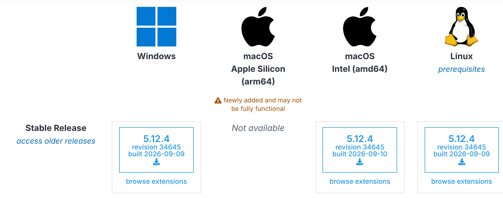
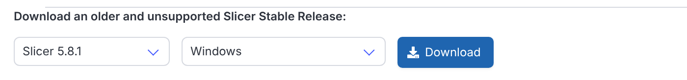
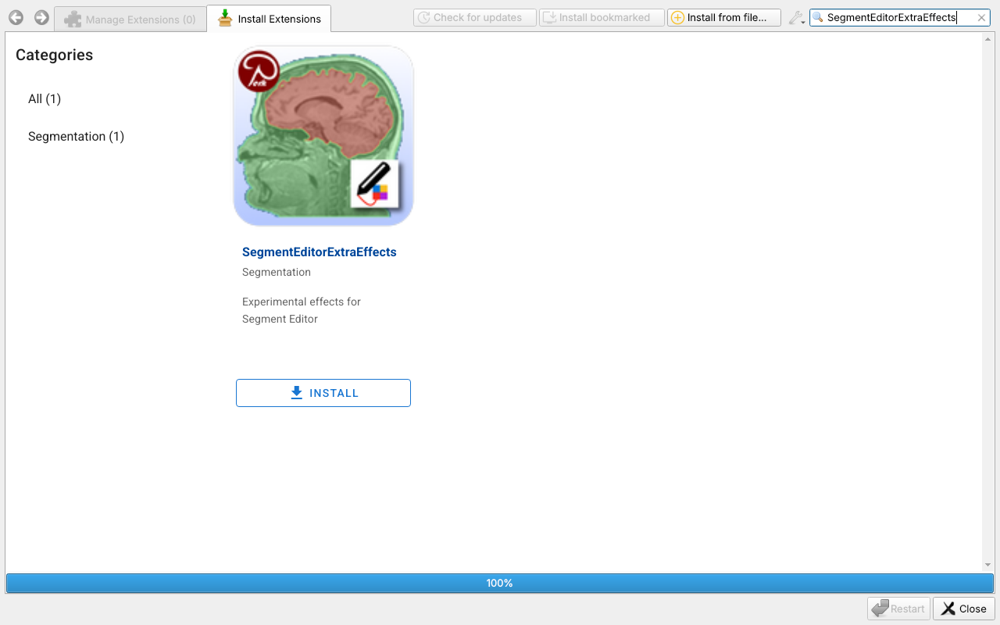
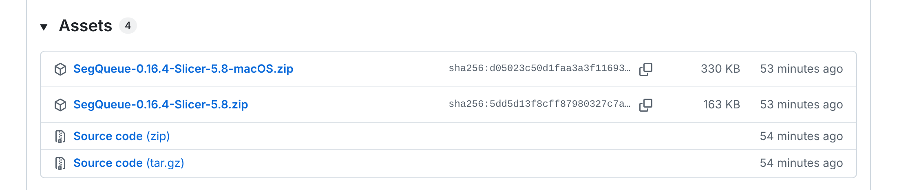
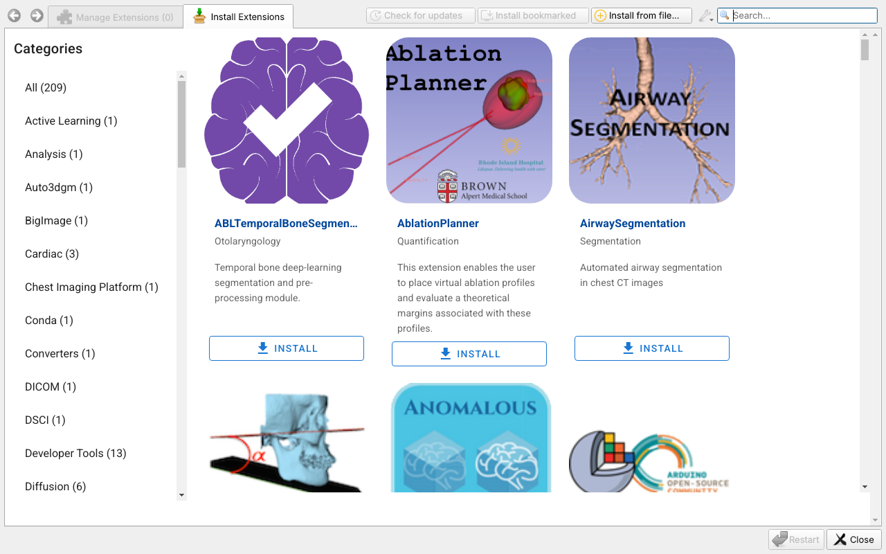
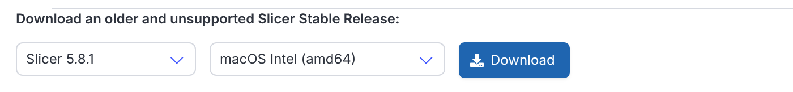
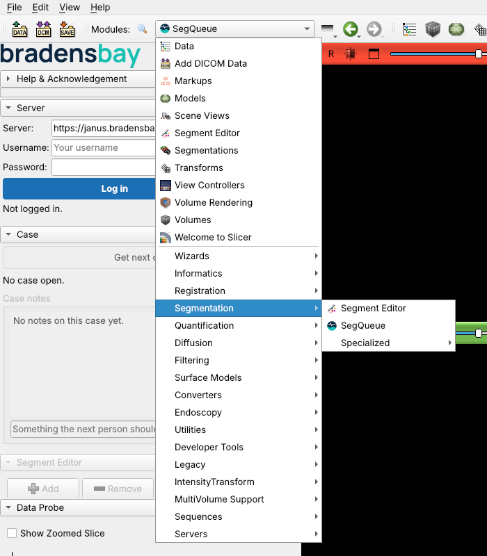
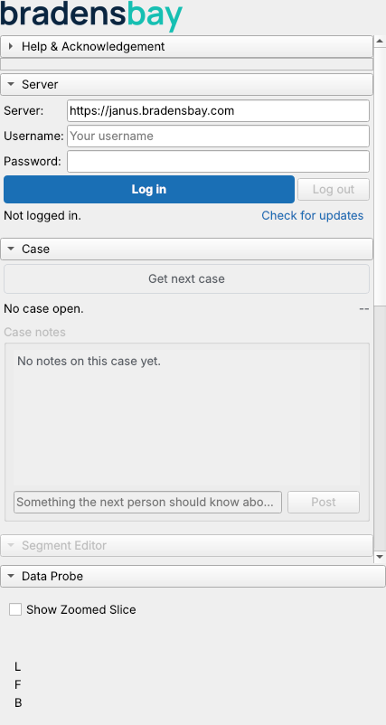

# SegQueue: getting set up as an annotator

Welcome to the team. This page gets SegQueue running on your computer and walks
you through your first case. It takes about 30 minutes, most of it download time.

You will need:

- Your username and password. The project lead sends these to you.
- The server address: `https://janus.bradensbay.com`
- A mouse with a scroll wheel. Segmenting with a trackpad is slow and tiring.

You do not need admin rights or any technical tools. If a step does not look like
what you see on screen, stop and ask the project lead. A screenshot helps.

Pick your system: [Windows](#windows) or [Mac](#mac). Both paths install the same
three things, in this order: 3D Slicer 5.8.1, the Draw tube extension, then the
SegQueue extension.

---

## Windows

### Step 1. Install 3D Slicer 5.8.1

SegQueue needs Slicer version **5.8.1** exactly. The big download buttons on the
Slicer site give you a newer version, so use the older releases list instead.

1. Go to https://download.slicer.org.
2. Under **Stable Release**, click the small link **access older releases**.

   

3. In the first dropdown choose **Slicer 5.8.1**, in the second choose
   **Windows**, and click **Download**.

   

4. Run the installer and accept the defaults.
5. If a blue box says "Windows protected your PC", click **More info**, then
   **Run anyway**. Windows shows that for any program it has not seen often.
6. Start Slicer once from the Start menu. The first start takes a minute.

### Step 2. Install the Draw tube extension

1. In Slicer, open **View**, then **Extensions Manager**.
2. Search for **SegmentEditorExtraEffects** and click **Install**.

   

3. Restart Slicer when it asks.

### Step 3. Install the SegQueue extension

1. Open https://github.com/christianGRogers/Asclepius/releases/latest in your
   browser and scroll down to **Assets**.
2. Download the file named `SegQueue-<version>-Slicer-5.8.zip`, the one
   **without** `macOS` in its name. Leave it as a zip file.

   

3. In Slicer, open **View**, then **Extensions Manager**.
4. Click **Install from file** at the bottom of the window, choose the zip you
   downloaded, and restart Slicer.

   

Now skip to [Logging in](#logging-in).

---

## Mac

### Step 1. Install 3D Slicer 5.8.1

SegQueue needs Slicer version **5.8.1** exactly. The big download buttons on the
Slicer site give you a newer version, so use the older releases list instead.
Slicer 5.8.1 comes as an Intel build only. It runs on Apple chip Macs (M1, M2,
M3, M4) through Rosetta, which your Mac offers to install the first time.

1. Go to https://download.slicer.org.
2. Under **Stable Release**, click the small link **access older releases**.

   

3. In the first dropdown choose **Slicer 5.8.1**, in the second choose
   **macOS Intel (amd64)**, and click **Download**. This is the right choice on
   every Mac, Intel or Apple chip.

   

4. Open the downloaded `.dmg` file and drag **Slicer** into your **Applications**
   folder.
5. Start Slicer from Applications. If your Mac says the app is from an unidentified
   developer, right-click the Slicer icon, choose **Open**, and confirm. You only
   do this once.
6. If your Mac offers to install **Rosetta**, accept. Slicer runs fine with it.

### Step 2. Install the Draw tube extension

1. In Slicer, open **View**, then **Extensions Manager**.
2. Search for **SegmentEditorExtraEffects** and click **Install**.

   

3. Restart Slicer when it asks.

### Step 3. Install the SegQueue extension

SegQueue installs through the Extensions Manager from a zip file, the same way as
on Windows. The one Mac wrinkle is Safari: by default it unzips every zip it
downloads, and Slicer needs the zip itself. Turn that off first.

1. **If you use Safari**, do one of these. Either open **Safari**, then
   **Settings**, then the **General** tab, and untick **Open "safe" files after
   downloading** (you can turn it back on afterwards). Or leave the setting alone
   and, in step 3, right-click the file name (Control-click, or a two-finger click
   on a trackpad) and choose **Download Linked File As**, which keeps it as a zip.
   If you use Chrome or Firefox, skip this step.
2. Open https://github.com/christianGRogers/Asclepius/releases/latest in your
   browser and scroll down to **Assets**.
3. Download the file named `SegQueue-<version>-Slicer-5.8-macOS.zip`, the one
   **with** `macOS` in its name. Leave it as a zip file.

   

4. Look in your Downloads folder. You should see the `.zip` file. If instead you
   see a folder called **SegQueue**, Safari unzipped it: delete that folder, do
   step 1, and download again.
5. In Slicer, open **View**, then **Extensions Manager**.
6. Click **Install from file** at the bottom of the window, choose the zip you
   downloaded, and restart Slicer.

   

---

## Logging in

1. In Slicer, open the module list (the dropdown at the top of the window), go to
   **Segmentation**, and choose **SegQueue**.

   

2. Check that the **Server** box says exactly `https://janus.bradensbay.com`. If
   it shows anything else, delete it and type that address. Slicer remembers it.
3. Enter your username and password and click **Log in**.

   

If you see "Update the SegQueue14 module", click **Check for updates** and then
**Update and restart**, then log in again.

## Your first case

1. Click **Get next case**. A CT scan loads with a yellow outline of the coronary
   arteries. The outline is automatic and rough. Your job is to turn it into four
   clean, correctly named vessels.
2. The four vessels are:

   | Name | Vessel | Must be filled in |
   |---|---|---|
   | LM | Left main | No (some people have none) |
   | LAD | Left anterior descending | Yes |
   | LCx | Left circumflex | Yes |
   | RCA | Right coronary artery | Yes |

   Each one starts as a hidden copy of the yellow outline.
3. In the Segment Editor, show one vessel at a time (click the eye next to its
   name) and erase everything that is not that vessel. Add any artery the outline
   missed, remove anything that is not a coronary artery, and keep the outline on
   the bright, contrast-filled part of the vessel.
4. Side branches belong to the vessel they come off. Diagonals and septals go with
   the LAD. Obtuse marginals go with the LCx. A ramus intermedius always goes with
   the LCx. A posterior descending or posterolateral branch goes with whichever
   artery it comes from.
5. Click **Submit case**. SegQueue will not let you submit if LAD, LCx or RCA is
   empty, or if any spot belongs to two vessels at once. It tells you which.

Useful buttons:

- **Save draft** keeps your work so you can carry on later.
- **Give this case back** returns a case you cannot finish.

Nothing is stored on your computer once a case is submitted.

## Keeping SegQueue up to date

Each time you open SegQueue it checks for a newer version. When one exists it
offers **Update and restart**. Click it. That is the whole update. You never need
to download a zip again.

## If something goes wrong

| What you see | What to do |
|---|---|
| "Failed to copy directory" while installing | You are on a newer Slicer than 5.8.1. Go back to Step 1 and install 5.8.1 from the older releases list, then install the zip again |
| A folder called SegQueue appeared instead of a zip (Mac) | Safari unzipped the download. Delete the folder, then either turn off "Open safe files" in Safari settings or right-click the file name and choose Download Linked File As, and download again |
| Install from file does not list your download | The file picker only shows zip files. If you only see a folder, see the row above |
| The Server box shows an address ending in `example.edu` | Replace it with `https://janus.bradensbay.com` |
| "Could not reach the server" | Check your internet connection and the Server box |
| SegQueue says Draw tube is missing | Go back to Step 2 and install SegmentEditorExtraEffects |
| SegQueue is not in the module list | Make sure you restarted Slicer after installing. If it is still missing, install the zip again |
| "Cannot submit" | Read the message. Either a required vessel is empty, or two vessels overlap somewhere |

Still stuck? Send the project lead a screenshot, your Slicer version (**Help**,
then **About 3D Slicer**), and whether you are on Windows, an Intel Mac or an
Apple chip Mac.
